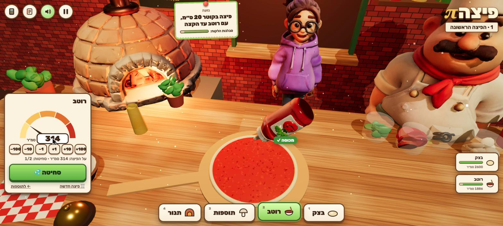

# פיצה π · Pizza Pi

A 3D pizzeria rush for Hebrew-speaking grade-8 students. You stretch dough by its **radius**, squeeze sauce that covers an **area**, wrap a cheese crust that runs the **circumference**, scale a regular's pie by a **percent**, and mix dough by **ratio**. Wrong math shows up on the pizza: a tray-sized pie, a bare charred ring, sauce flooding the counter, cheese oozing from a crust gap, dough that tears.

Seven authored levels (≈ 6–10 minutes), ending in a no-hints rush hour. Stack: TypeScript, Vite, Three.js. Models: Tripo (rigged and animated characters). UI target: gpt-image mockups in `design/mockups/`.



## Run

```bash
npm install
npm run dev        # http://localhost:5177
npm test           # rules + game state machine (node:test via tsx)
npm run build      # static build in dist/ (relative base, works offline)
```

Open with `?level=N` (1–7) to jump to a level.

## Controls

| | Mouse / touch | Keyboard |
|---|---|---|
| Stations (right → left): קערה · בצק · רוטב · קרום · תוספות · תנור | tap the tabs at the bottom | `1`–`6` |
| Stretch the dough | drag from the centre outward (the ruler reads the radius) | `←` `→` ±0.5 cm |
| Sauce | type cm² in the gauge or use the ± chips, then **סחיטה** (one top-up allowed) | `←` `→` ±10 (Shift ±1), `Enter` |
| Cheese crust | drag along the yellow tape, then **חיתוך** | `←` `→` ±0.5 (Shift ±5), `Enter` |
| Toppings (optional) | tap the jars or chips | |
| Oven / serve | **לתנור**, then the bell **הגשה** | `Enter` |
| Chef's notebook (formula with your numbers, not the answer; logged) | 📒 | `H` |
| Calculator | 🧮 | `C` |
| Pause / mute | ⏸ / 🔊 | `P` or `Esc` / `M` |

Reduced motion: toggle on the title or pause screen (also follows the OS setting).

## Structure

- `src/rules.ts`: pure math and judging (area, circumference, the 0.5 cm grid, tolerances, named mistakes such as `used_diameter_as_radius` and `sauce_scaled_linearly`).
- `src/levels.ts`: the seven authored levels and their stock.
- `src/game.ts`: a deterministic state machine (stations, busy timers, stock, tickets, shift clock, event log). No Three.js and no DOM.
- `src/scene.ts`: Three.js rendering. The math-critical shapes are exact procedural geometry.
- `src/main.ts`: HUD, input, overlays, calculator, test hooks.
- `src/audio.ts`: procedural WebAudio.
- `tests/`: 21 unit tests. Every ticket has a legal perfect solution within stock, and each wrong approach produces its advertised consequence.

Test hooks: `window.render_game_to_text()` returns the level, order, r/d/area/sauce/cheese, required ranges, stock, timers and the last outcome; `window.advanceTime(ms)` steps the game deterministically.

Learning events (level, ticket, attempt, action, values, outcome, hint) are kept in `localStorage` (`pizza-pi-events-v1`) only. There is no network, no accounts and no analytics.

See `CURRICULUM.md`, `ASSETS.md`, `PLAYTEST.md` and `progress.md`.
